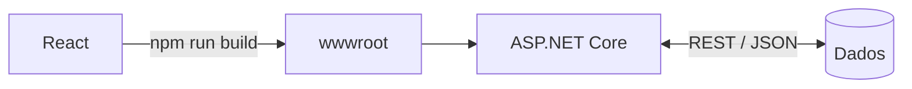

<div align="center">


<br>

<a href="https://www.linkedin.com/in/adrian-ariel-2b23b3349/"></a>
<a href="mailto:pedaeadr@gmail.com"></a>

</div>

<br>

### Sobre

Desenvolvedor focado em **APIs REST com C# / ASP.NET Core** e **interfaces em React**, cursando Análise e Desenvolvimento de Sistemas.

Minha formação técnica em Administração me faz começar pelo problema, não pelo código: entender a regra de negócio, mapear o fluxo e só então modelar a solução. No desenvolvimento, prezo por orientação a objetos, código limpo e projetos que funcionam de ponta a ponta.

```csharp
public record Adrian
{
    public string   Formacao    => "Análise e Desenvolvimento de Sistemas (cursando)";
    public string[] Back        => ["C#", "ASP.NET Core", "APIs REST"];
    public string[] Front       => ["React", "JavaScript", "HTML", "CSS"];
    public string[] Extras      => ["Python", "Git", "Automação"];
    public string   Diferencial => "Regra de negócio antes do código.";
}
```

<br>

### Como eu construo

O front em React é compilado e servido pela própria API em ASP.NET Core a partir da pasta `wwwroot`: um único deploy, mesma origem (sem dor de cabeça com CORS) e rodando em servidor local.



<br>

### Stack

<p align="left">
  
</p>

<br>

### Projetos

<table>
  <tr>
    <td width="50%" valign="top">
      <a href="https://github.com/SEU_USUARIO/EclipseWall-API"><b>EclipseWall-API</b></a><br>
      <sub>Web API em ASP.NET Core que serve a plataforma de wallpapers EclipseWalls.</sub><br><br>
      <code>C#</code> <code>ASP.NET Core</code> <code>REST</code>
    </td>
    <td width="50%" valign="top">
      <a href="https://github.com/SEU_USUARIO/Dropbase-BE"><b>Dropbase-BE</b></a><br>
      <sub>Backend do Dropbase: upload, armazenamento e gerenciamento de arquivos.</sub><br><br>
      <code>C#</code> <code>ASP.NET Core</code> <code>REST</code>
    </td>
  </tr>
  <tr>
    <td width="50%" valign="top">
      <a href="https://github.com/SEU_USUARIO/Nexus"><b>Nexus</b></a><br>
      <sub>Clone do Discord com servidores, canais, mensagens em tempo real e chamadas de voz e vídeo.</sub><br><br>
      <code>JavaScript</code> <code>Tempo real</code>
    </td>
    <td width="50%" valign="top">
      <a href="https://github.com/SEU_USUARIO/GhostPad"><b>GhostPad</b></a><br>
      <sub>Usa o celular como ponte Bluetooth para jogar no PC com qualquer controle, emulando um Xbox 360 virtual.</sub><br><br>
      <code>Python</code> <code>Flet</code> <code>Bluetooth</code>
    </td>
  </tr>
  <tr>
    <td width="50%" valign="top">
      <a href="https://github.com/SEU_USUARIO/TimeSleep"><b>TimeSleep</b></a><br>
      <sub>Sleep timer para PC inspirado nas TVs: dial circular, janela própria e notificações.</sub><br><br>
      <code>JavaScript</code> <code>Desktop</code>
    </td>
    <td width="50%" valign="top">
      <a href="https://github.com/SEU_USUARIO/Steam"><b>Steam</b></a><br>
      <sub>Site de jogos com visual escuro e imersivo: carrossel de destaques, lançamentos e trailers.</sub><br><br>
      <code>JavaScript</code> <code>UI</code>
    </td>
  </tr>
</table>

<br>

### Agora

- Aprofundando arquitetura de APIs REST em C#
- Integrando React e ASP.NET Core em projetos completos
- Aberto a oportunidades e colaborações

<br>

<div align="center">
  <sub>Construindo, quebrando e aprendendo, um commit por vez.</sub>
</div>
